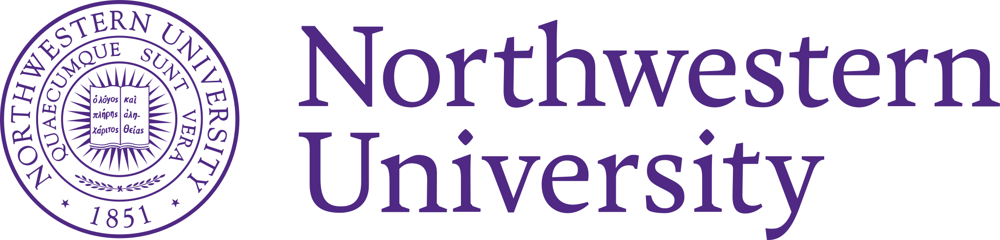

## Hi, I'm Zhenglin! 👋 

  

  <b>M.S. in Machine Learning and Data Science (MLDS)</b> | Northwestern University  
  <b>B.A. in Applied Mathematics with Honors</b> | Boston University

  <b>Data Science · Statistical Modeling · Machine Learning · Predictive Analytics</b>

  
I'm a graduate student passionate about applying statistical methods and machine learning to solve real-world problems. My experience spans predictive modeling, model evaluation, data analytics, and end-to-end data workflows through academic research, industry internships, and personal projects.

🎯 **Currently seeking Summer 2027 Data Science Internship opportunities.**

---

### 🚀 Featured Projects

#### [Undergraduate Honors Thesis — Distance-Based Learning](https://github.com/zhenglin0619/bu-honors-thesis)

Developed two novel methods to improve classical distance-based learning: **Reliability-Weighted All-Neighbors (RWAN)** for robust classification and **Diffusion-Map Density-Coverage (DMDC)** for clustering initialization. Evaluated their performance under noisy observations and nonlinear data geometry.

**Keywords:** Statistical Learning · Classification · Clustering · Manifold Learning · Algorithm Design

#### [Let's Go — Personal Travel Analytics Journal](https://github.com/zhenglin0619/letsgo)

Developed and deployed a full-stack travel application featuring structured data management, interactive geographic visualizations, and analytics dashboards. Designed relational data models using PostgreSQL and integrated authentication, collaborative features, and map-based exploration.

**Tech:** Next.js · TypeScript · PostgreSQL · Supabase · Data Visualization

---

### 🛠 Tech Stack

  

**Programming:** Python · SQL · R · Java · TypeScript

**Machine Learning:** scikit-learn · XGBoost · PyTorch · TensorFlow · SHAP

**Data Analysis & Visualization:** pandas · NumPy · SciPy · Matplotlib · Seaborn · Tableau · Power BI · Excel

**Databases:** PostgreSQL · MySQL · Microsoft SQL Server · MongoDB · DynamoDB

**Data Engineering & Tools:** Databricks · Apache Airflow · Docker · Git · GitHub · Supabase

**Statistical Methods:** Statistical Inference · Regression Analysis · Hypothesis Testing · A/B Testing

---

### 📊 Data Science Experience Highlights

- **Predictive Modeling:** Developed a flight-delay prediction pipeline using **150,000+ flight records**, comparing machine learning models with time-aware cross-validation. Applied **XGBoost, isotonic calibration, and SHAP**, achieving **0.94 ROC-AUC**.

- **Data Analytics & Infrastructure:** Built SQL-based analytics dashboards for GPU rental activity, utilization, and operational performance. Worked with data from a distributed GPU computing platform to support monitoring and business analysis.

---

### 📫 Connect With Me
- 🌐 **Portfolio:** [zhenglin.netlify.app](https://zhenglin.netlify.app/)
- 💼 **LinkedIn:** [linkedin.com/in/zhenglin-wang](https://www.linkedin.com/in/zhenglin-wang)
- ✉️ **Email:** [zhenglin0619@gmail.com](mailto:zhenglin0619@gmail.com)

<h3 align="center">
  <b>Thanks for visiting my profile!</b>
</h3>

  I'm always interested in discussing data science, machine learning, and opportunities to collaborate on meaningful projects.

